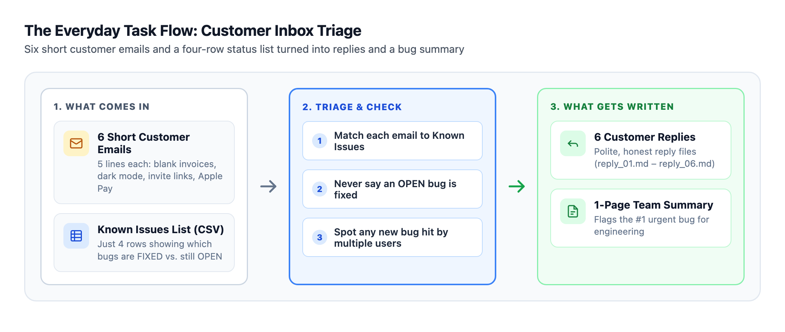
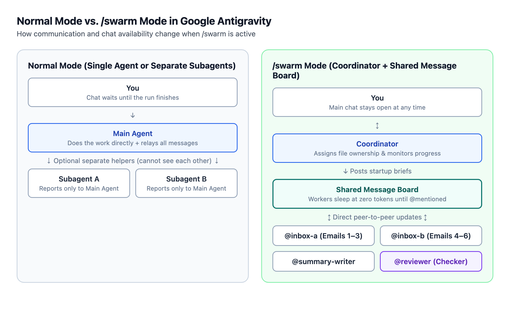
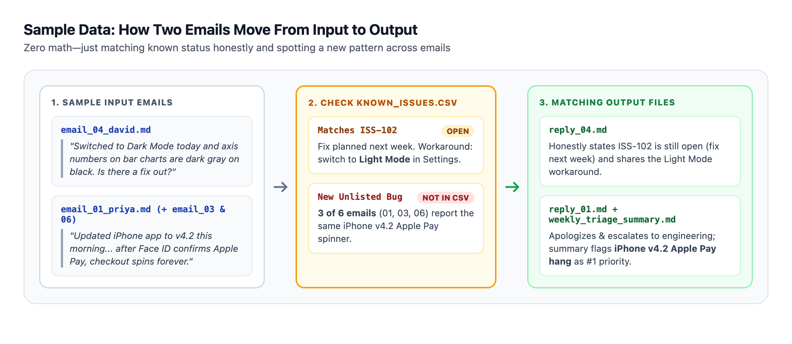
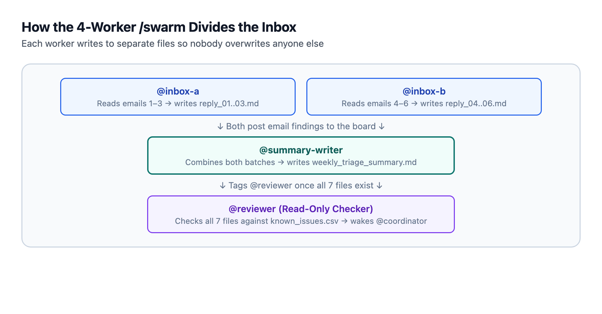
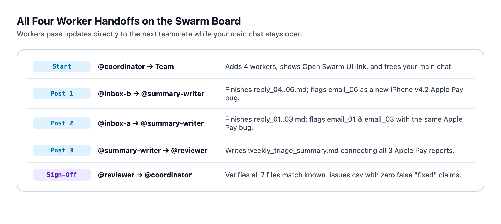
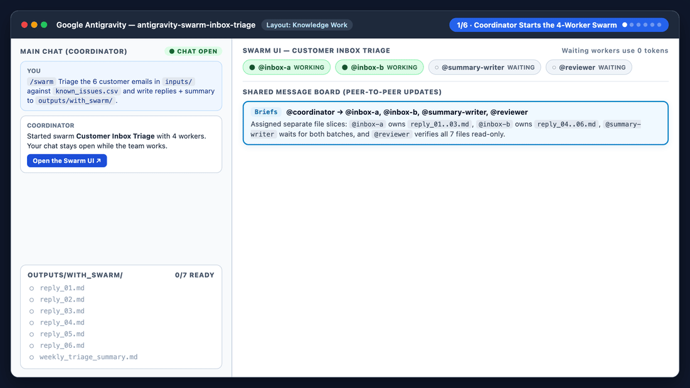
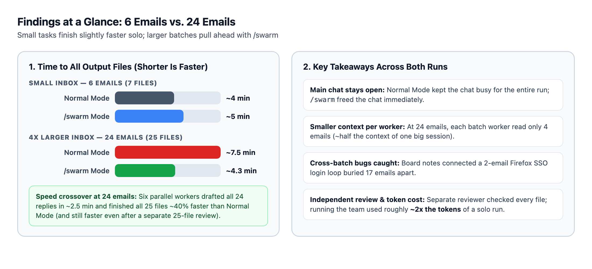

# Getting More Done in Parallel with `/swarm` in Google Antigravity

*A practical guide to parallel agents, shared message boards, and Interface Layouts (`Software Engineering` and `Knowledge Work`) in Google Antigravity.*

<!-- Alternate Title Options:
1. Working with a Team of Agents in Google Antigravity Using /swarm
2. Parallel Agent Collaboration and Peer Review with /swarm in Google Antigravity
3. How /swarm Works in Google Antigravity: A Practical Step-by-Step Guide
4. Scaling Multi-File Work in Google Antigravity with /swarm
-->

---

Most work in **Google Antigravity** starts in a single chat. You describe what you want, and one agent does the work step by step.

That works well for small tasks, like editing one file or answering one question. Larger tasks are slower in a single thread. Suppose you need to read a stack of customer emails, check a status list, write an individual reply for each person, and summarize the top bug for your team. Doing all of that in one chat takes longer, fills up one conversation, and keeps your chat busy until every file is done.

That is where `/swarm` helps. Instead of one agent doing every step in order, `/swarm` starts a small team of agents that work in parallel. They share notes on a common message board, a separate reviewer checks their output, and your main chat stays open the whole time.

If you are trying `/swarm` for the first time, two questions usually come up:

1. **"How is `/swarm` different from giving one detailed prompt to a single agent?"**
2. **"Antigravity can already start subagents in normal mode—what does `/swarm` add?"**

In this tutorial, we answer both questions in plain terms. We walk through a simple customer-support example with illustrated diagrams, run the task without `/swarm` and with `/swarm` at two inbox sizes (6 emails and 24 emails), and share the main takeaways.

### What We Will Cover
1. **Simple Overview:** How Normal Mode, Subagents, and `/swarm` differ.
2. **What Happens When You Type `/swarm`:** What opens on screen and how Antigravity behaves.
3. **Interface Layouts (`Knowledge Work` and `Software Engineering`):** How Antigravity adapts its UI for non-coding and coding tasks.
4. **The Test Scenario (Customer Inbox Triage):** Six short customer emails and a four-row status table, with simple diagrams showing how the team works.
5. **Step-by-Step Walkthrough:** Six ordered steps to clone the repository, inspect the files, and run both modes yourself.
6. **What Happened in Our 6-Email Walkthrough:** Swarm replay and sample generated output.
7. **Scaling Up (6 Emails vs. 24 Emails) & Summary of Findings:** What changed when inbox volume quadrupled, and how to try the 24-email batch yourself.
8. **Where `/swarm` Helps Most & Practical Tips:** Common use cases across both layouts and habits for clean runs.
9. **Conclusion and Next Steps:** Key takeaways and links to further reading.

### Prerequisites
* **Google Antigravity** installed on macOS, Windows, or Linux (with an active plan and model that supports `/swarm`).
* **`git`** installed to clone the companion repository: [rominirani/antigravity-swarm-inbox-triage](https://github.com/rominirani/antigravity-swarm-inbox-triage).
* About **10–15 minutes** to clone the folder and run both prompts locally. No external API keys or cloud setup are needed.

---

## 1. Simple Overview: Three Ways Antigravity Can Work

Imagine it is Monday morning and your support inbox has **six short customer emails**. You also have a tiny **four-row list of known issues** showing which bugs are already `FIXED` and which ones are still `OPEN`. You want to write a polite, honest reply to each customer and a 1-page summary for your engineering team.



Antigravity can handle that job in three ways:

### Mode A: One Agent Doing Everything in Order (Typical Normal Mode)
One agent reads the guidelines, reads Email 1 through Email 6, writes Reply 1 through Reply 6 one after another, writes the summary, and checks its own work.
* **The trade-off:** Your chat stays occupied until all steps finish. Also, if your inbox has dozens of emails instead of 6, putting all of them into one conversation makes the context large, and small details from earlier messages are easier to miss.

### Mode B: One Main Agent Using Subagents (Normal Mode with Subagents)
Even without `/swarm`, Antigravity can launch background subagents on its own. Two limits still apply:
1. **Subagents are optional:** On small or medium tasks, the main agent often decides to do everything itself in one thread.
2. **Subagents cannot talk to each other:** Subagent A does not know Subagent B exists. Every finding goes back to the main agent, which has to read it and pass notes to the next subagent.

### Mode C: A Coordinator and a Shared Message Board (`/swarm` Mode)
Typing `/swarm` changes how the team is set up:
* **The main agent acts only as a Coordinator:** It does not write code or documents itself. It creates named workers (such as two inbox workers, a summary writer, and a reviewer), assigns each one separate files, and ends its turn so your chat stays free.
* **Workers share one message board:** Workers post numbered updates to a shared board and wake the next teammate directly using `@name` without routing through the Coordinator.
* **Idle workers cost nothing while waiting:** A worker waiting on the board (`waiting` state) uses zero tokens until another post mentions its `@name` or `@all`.
* **Separate review session:** `/swarm` adds a reviewer in its own conversation. Because the reviewer did not write the drafts, it checks every reply independently against your list of known issues before finishing.



> [!IMPORTANT]
> **Why a single prompt still has limits:** Clear prompting always helps, but one agent still works in a single line. Four limits remain: **(1) Time** (writing files one by one), **(2) Context size** (loading many files into one chat), **(3) Self-review** (checking work in the same chat that wrote it), and **(4) Shared clues** (when two workers spot customers hitting the same new bug across different batches).

---

## 2. What Happens When You Type `/swarm`?

Using `/swarm` does not require any setup files:

1. **How you start it:** Type `/swarm` at the start of your prompt and describe your goal in plain language. You do not need to invent worker names unless you want a specific layout.
2. **What opens on screen:** Your main chat becomes the Coordinator, starts the workers, and shows an **Open the Swarm UI** link. Clicking it opens the Swarm Board panel, where you can watch each worker's status (`working` or `waiting`) and read every numbered message.
3. **How you interact mid-run:** You still talk only to your main chat. Because the Coordinator finishes its turn right away, you can send new instructions or ask for status at any point while the workers run.

Here is how Antigravity behaves without `/swarm` compared to with `/swarm`:

| Area | Normal Mode (Without `/swarm`) | Swarm Mode (With `/swarm`) |
| :--- | :--- | :--- |
| **Splitting the task** | **Optional.** The agent decides whether to use subagents or work in one thread. | **Required.** The Coordinator splits the task across named workers with separate files. |
| **Main agent's job** | **Does the work.** Reads files and writes outputs while your turn waits. | **Coordinator only.** Assigns work and ends its turn so your chat stays open. |
| **Worker communication** | **Through the main agent.** Subagents cannot read each other's messages. | **Peer-to-peer.** Workers read board posts and `@mention` the next worker directly. |
| **Checking the output** | **Self-check.** The same conversation writes and checks its own files. | **Separate reviewer.** A dedicated reviewer checks outputs and sends fixes back to authors. |
| **Visibility & monitoring** | Tool calls appear in the main chat (or subagent logs). | **Swarm UI board** shows every post, and a **`monitor`** checks for stalled handoffs. |
| **File isolation (for code)** | Uses the main workspace unless branched. | Each coding worker can run in its own isolated Git copy, or branch off another worker's context. |

---

## 3. Interface Layouts: `Knowledge Work` and `Software Engineering`

Antigravity is built for both software development and everyday document work. Under **`Settings` (`Cmd+,` on macOS / `Ctrl+,` on Windows and Linux) -> `General` -> `Interface Layout`**, you can switch between two layouts at any time without restarting the app:

* **`Software Engineering` Layout:** Built for code repositories. It shows Git branch and worktree pickers, "Open in IDE" links, expandable tool-call groups, inline code diffs, and side panels for **Review, Files, Terminal, and Extensions**.
* **`Knowledge Work` Layout:** Built for support, operations, product, sales, finance, and research work. It opens standard folders without asking for Git branches, replaces code diffs with a simple progress line and plain-language permission prompts, and shows side panels for **Folders, Documents, Artifacts, Links, Uploads, and Background Tasks**.

Both layouts run on the **same agent engine, models, local files, plugins (such as Google Drive, Docs, Sheets, and Slides), MCP servers, and `/swarm` command**. Only the workspace layout around your chat changes:

| Feature | `Software Engineering` Layout | `Knowledge Work` Layout |
| :--- | :--- | :--- |
| **Typical Tasks** | Codebases, refactors, tests, debugging | Emails, reports, spreadsheets, slide decks, research |
| **Project Setup** | Git repositories, branch pickers, worktrees, IDE handoff | Standard folders or standalone conversations |
| **Activity & Approvals** | Expandable tool-call groups, inline code diffs, command rules | Clean live progress line and plain-language permission prompts |
| **Side Panels** | Review, Files, Terminal, Extensions | Folders, Documents, Artifacts, Links, Uploads, Background Tasks |
| **`/swarm` Support** | Full support (isolated Git worktrees and Swarm UI) | Full support (parallel readers, writers, reviewers, and Swarm UI) |

Our inbox triage scenario below uses plain text files and a tiny CSV rather than application code. If you follow along locally, try switching to **`Knowledge Work`** in Settings while running it, then switch back to **`Software Engineering`** whenever you return to code.

---

## 4. The Test Scenario: Customer Inbox Triage

All **8 input files** in our starter folder (`reply_guidelines.md`, `known_issues.csv`, and 6 short customer emails) add up to **under 60 lines of plain text**, so you can read the entire dataset in about a minute.

Here is the complete `known_issues.csv` file (all 4 rows):

```csv
issue_id,title,status,customer_guidance
ISS-101,PDF invoice downloads as a blank page,FIXED in v4.2,Ask customer to refresh browser or update to v4.2 and download the invoice again
ISS-102,Dark mode text is hard to read on dashboard charts,OPEN,Be upfront that the fix is planned for next week; temporary workaround is switching to Light Mode in Settings > Appearance
ISS-103,CSV export stops at 500 rows,FIXED in v4.1,Resolved in v4.1; full exports work automatically once updated
ISS-104,Team invite email button says link expired,OPEN,Be upfront that it is still open; workaround is copying the direct invite URL from Settings > Team > Copy Link
```

### Sample Data: How Two Emails Move From Input to Output

No math is involved. Each email either matches a row in `known_issues.csv` (`FIXED` or `OPEN`) or reveals a **new unlisted bug** that needs to be escalated:



Across the 6 emails (`email_01` through `email_06`):
* **One email matches a `FIXED` bug:** `email_02` (blank PDF invoice → `ISS-101`, fixed in `v4.2`).
* **Two emails match `OPEN` bugs:** `email_04` (Dark Mode chart labels → `ISS-102`) and `email_05` (expired invite button → `ISS-104`). Replies must be upfront that these are still open and share the listed workaround.
* **Three emails report the same new unlisted bug:** `email_01`, `email_03`, and `email_06` all report that **Apple Pay freezes on a spinning wheel on iPhone right after updating to `v4.2`**.

### How the 4-Worker `/swarm` Divides the Inbox

One basic rule in `/swarm` is that **two workers should not edit the same file at the same time**. Our starter swarm splits the work across four roles—two inbox workers drafting separate replies in parallel, one summary writer combining their board notes, and one read-only reviewer checking all 7 outputs:



### Who Talks to Whom on the Message Board

Between starting the 4 workers and receiving the final sign-off, the Coordinator sends zero messages. The entire run takes just **four worker posts** on the board:



---

## 5. Step-by-Step Walkthrough: Clone and Run the Scenario Yourself

Everything lives in the companion GitHub repository: [rominirani/antigravity-swarm-inbox-triage](https://github.com/rominirani/antigravity-swarm-inbox-triage).

```text
antigravity-swarm-inbox-triage/
├── README.md                             # Quickstart instructions
├── BLOG_POST.md                          # Companion tutorial article
├── assets/
│   ├── images/                           # Diagrams & animated Swarm Board replay GIF
│   └── video/
│       └── inbox_swarm_replay.mp4        # 1080p MP4 replay of the 4-worker /swarm run
├── inputs/                               # 6-email starter inbox (Sections 4–6)
│   ├── reply_guidelines.md               # Simple rules for replying & summarizing
│   ├── known_issues.csv                  # 4 known issues (FIXED or OPEN + workarounds)
│   └── emails/                           # 6 short customer emails (email_01..06)
├── inputs_24/                            # 24-email larger inbox (Section 7)
│   ├── reply_guidelines.md
│   ├── known_issues.csv
│   └── emails/                           # 24 customer emails (email_01..24)
├── prompts/
│   ├── prompt_without_swarm.txt          # 6-email Run 1 prompt (Normal Mode)
│   ├── prompt_with_swarm.txt             # 6-email Run 2 prompt (/swarm Mode)
│   ├── prompt_24_without_swarm.txt       # 24-email Run 1 prompt (Normal Mode)
│   └── prompt_24_with_swarm.txt          # 24-email Run 2 prompt (/swarm Mode)
├── outputs/                              # Reference outputs for 6-email runs
│   ├── without_swarm/
│   └── with_swarm/
├── outputs_24/                           # Reference outputs for 24-email runs
│   ├── without_swarm/
│   └── with_swarm/
└── logs/
    ├── swarm_board_log.md                # Recorded 6-email Swarm Board messages
    └── swarm_board_log_24.md             # Recorded 24-email Swarm Board messages
```

Follow these six steps in order to clone the repository, inspect the files, and run both modes yourself:

### Step 1: Clone the Repository and Open It in Antigravity
1. Clone the repository to your machine:
   ```bash
   git clone https://github.com/rominirani/antigravity-swarm-inbox-triage.git
   cd antigravity-swarm-inbox-triage
   ```
2. Open **Google Antigravity**, select **Projects** (or **Folders** if you are already in `Knowledge Work` layout) in the left sidebar, and open the cloned `antigravity-swarm-inbox-triage` folder.
3. *(Optional)* Press `Cmd+,` (macOS) or `Ctrl+,` (Windows and Linux) to open **Settings**, go to **General -> Interface Layout**, and select **`Knowledge Work`** to try the folder-and-document view.

### Step 2: Skim the Key Input Files First (About 1 Minute)
Open these short files inside `inputs/` so you know what to check in the generated replies:
1. **[reply_guidelines.md](https://github.com/rominirani/antigravity-swarm-inbox-triage/blob/main/inputs/reply_guidelines.md) and [known_issues.csv](https://github.com/rominirani/antigravity-swarm-inbox-triage/blob/main/inputs/known_issues.csv):** Notice which two issues are `FIXED` (`ISS-101`, `ISS-103`) and which two are still `OPEN` (`ISS-102` Dark Mode, `ISS-104` Invite Link).
2. **[email_04_david.md](https://github.com/rominirani/antigravity-swarm-inbox-triage/blob/main/inputs/emails/email_04_david.md):** David asks if Dark Mode chart labels are already fixed. Because `ISS-102` is `OPEN`, a good reply must be honest that the fix ships next week and share the Light Mode workaround.
3. **[email_01_priya.md](https://github.com/rominirani/antigravity-swarm-inbox-triage/blob/main/inputs/emails/email_01_priya.md) and [email_03_elena.md](https://github.com/rominirani/antigravity-swarm-inbox-triage/blob/main/inputs/emails/email_03_elena.md):** Both describe Apple Pay spinning forever on iPhone after updating to `v4.2`—a bug that is not in `known_issues.csv` at all.

### Step 3: Clear the Reference Output Folders
From inside your `antigravity-swarm-inbox-triage` folder, empty `outputs/` so you can watch all 7 files get created fresh:

```bash
# macOS / Linux (on Windows PowerShell, use: Remove-Item outputs\without_swarm\*, outputs\with_swarm\*)
rm -f outputs/without_swarm/* outputs/with_swarm/*
```

*(You can restore the original reference files anytime with `git checkout -- outputs/`.)*

### Step 4: Run 1 — Try Normal Mode (Without `/swarm`)
1. Click **New Conversation** in the left sidebar.
2. Paste the prompt from [prompt_without_swarm.txt](https://github.com/rominirani/antigravity-swarm-inbox-triage/blob/main/prompts/prompt_without_swarm.txt) and press Enter:

```text
Triage the 6 customer emails in inputs/:
- Read inputs/reply_guidelines.md and inputs/known_issues.csv.
- Read all 6 customer emails in inputs/emails/.
- Write reply_01.md through reply_06.md plus weekly_triage_summary.md inside outputs/without_swarm/, making sure every reply matches known_issues.csv accurately and any new unlisted bug is flagged clearly.
```

3. **What to watch:** Notice how the agent handles everything inside one conversation and keeps your chat occupied until all 7 files are written. Wait for Run 1 to finish before starting Run 2.

### Step 5: Run 2 — Try Swarm Mode (With `/swarm`)
1. Click **New Conversation** so Run 2 starts in a clean session.
2. Paste [prompt_with_swarm.txt](https://github.com/rominirani/antigravity-swarm-inbox-triage/blob/main/prompts/prompt_with_swarm.txt)—which adds `/swarm` at the start and writes to `outputs/with_swarm/`—and press Enter:

```text
/swarm Triage the 6 customer emails in inputs/:
- Read inputs/reply_guidelines.md and inputs/known_issues.csv.
- Read all 6 customer emails in inputs/emails/.
- Write reply_01.md through reply_06.md plus weekly_triage_summary.md inside outputs/with_swarm/, making sure every reply matches known_issues.csv accurately and any new unlisted bug is flagged clearly.
```

3. **What to do while Run 2 runs:**
   * **Open the Swarm Board:** Click **Open the Swarm UI** as soon as the Coordinator finishes setting up the team. Watch the parallel inbox workers draft replies, pass their notes to the summary writer, and hand off to the reviewer *(the Coordinator picks worker names automatically—for example `@inbox-a` and `@inbox-b`—so your exact names may vary)*.
   * **Try chatting mid-run (optional):** Send a short message in your main chat—such as *"What is the current status of the swarm?"*—to see how the Coordinator replies while the workers keep going.
   * Wait until the Coordinator posts its final completion summary after the reviewer signs off.

### Step 6: Check Your Generated Files
Open `outputs/without_swarm/` and `outputs/with_swarm/` and verify three simple things:
1. All 6 replies (`reply_01.md`–`reply_06.md`) include a `Subject:` line and polite, accurate steps.
2. Neither `reply_04.md` (`ISS-102`) nor `reply_05.md` (`ISS-104`) claims an `OPEN` issue is already fixed.
3. `weekly_triage_summary.md` connects `email_01`, `email_03`, and `email_06` as the #1 engineering priority: **Apple Pay hanging on iPhone after the `v4.2` update**.

---

## 6. What Happened in Our 6-Email Walkthrough: Swarm Replay and Sample Output

Both runs classified all 6 customer emails accurately ([outputs/without_swarm/weekly_triage_summary.md](https://github.com/rominirani/antigravity-swarm-inbox-triage/blob/main/outputs/without_swarm/weekly_triage_summary.md) vs. [outputs/with_swarm/weekly_triage_summary.md](https://github.com/rominirani/antigravity-swarm-inbox-triage/blob/main/outputs/with_swarm/weekly_triage_summary.md)), while behaving quite differently during execution:

* **Run 1 (Without `/swarm`):** Even though Antigravity can launch subagents in normal mode, the agent chose to do everything itself (**`0` subagents**). It read all 6 emails in one thread, wrote all 7 files one after another in roughly **4 minutes**, and kept the main chat busy until the end.
* **Run 2 (With `/swarm`):** The Coordinator created the 4 workers (`inbox-a`, `inbox-b`, `summary-writer`, `reviewer`), displayed the **Open the Swarm UI** link, and freed the main chat immediately. `inbox-a` and `inbox-b` drafted their replies in parallel, `summary-writer` combined their board posts ([logs/swarm_board_log.md](https://github.com/rominirani/antigravity-swarm-inbox-triage/blob/main/logs/swarm_board_log.md)), and `reviewer` verified all 7 files against `known_issues.csv` before signing off (~5 minutes end-to-end).

Here is a step-by-step replay of the `/swarm` run across the main chat, file list, and shared message board *(1080p MP4 also available at [assets/video/inbox_swarm_replay.mp4](https://github.com/rominirani/antigravity-swarm-inbox-triage/blob/main/assets/video/inbox_swarm_replay.mp4))*:



### Sample Output Generated by `/swarm`

Here is one of the six customer replies written by `@inbox-a` ([outputs/with_swarm/reply_01.md](https://github.com/rominirani/antigravity-swarm-inbox-triage/blob/main/outputs/with_swarm/reply_01.md)), escalating Priya's unlisted Apple Pay bug honestly and sharing the manual card workaround:

```markdown
Subject: Re: Checkout stuck spinning on Apple Pay

Hi Priya,

I sincerely apologize for the trouble renewing your team plan. This Apple Pay checkout hang on the iPhone app (v4.2, spinning indefinitely after Face ID confirmation) is a new bug not yet fixed, and I am escalating it to our engineering team right away alongside another matching iPhone v4.2 report.

If you need to complete your renewal today, entering a standard credit or debit card number directly at checkout is working normally as a temporary workaround while our engineers investigate, and we will follow up as soon as a fix is live.

Best regards,
Customer Support Team
```

And here is the core triage summary produced by `@summary-writer` ([outputs/with_swarm/weekly_triage_summary.md](https://github.com/rominirani/antigravity-swarm-inbox-triage/blob/main/outputs/with_swarm/weekly_triage_summary.md)) after combining the board updates from `@inbox-a` and `@inbox-b` and passing `@reviewer` sign-off:

```markdown
## 1. Email-to-Issue Triage Mapping
- email_01 (Priya Sharma)    -> NEW UNLISTED BUG (Escalated: iPhone app v4.2 Apple Pay hang)
- email_02 (Marcus Bell)     -> ISS-101 (FIXED in v4.2: refresh old tab & re-download PDF)
- email_03 (Elena Rostova)   -> NEW UNLISTED BUG (Escalated: iPhone Safari v4.2 Apple Pay hang)
- email_04 (David Kim)       -> ISS-102 (OPEN: fix next week; workaround is Light Mode)
- email_05 (Sara Al-Mansoor) -> ISS-104 (OPEN: copy direct link via Settings > Team > Copy Link)
- email_06 (Omar Hassan)     -> NEW UNLISTED BUG (Escalated: iPhone v4.2 Apple Pay hang)

## 2. Top Engineering Priority: iPhone v4.2 Apple Pay Infinite Spinner
- Volume: 3 of 6 emails (email_01, email_03, email_06 — 50% of inbox volume).
- Shared Pattern: Affects both the native iPhone app and mobile Safari immediately
  after updating to v4.2; manual credit card entry still succeeds.
```

---

## 7. Scaling Up to 24 Emails: Summary of Findings

On just 6 short emails, a single agent finished slightly sooner (~4 minutes vs. ~5 minutes with review). That raises a practical question: *what happens when Monday morning's inbox is four times larger?*

To find out, we ran the exact same guidelines and `known_issues.csv` on a **24-email folder** ([inputs_24](https://github.com/rominirani/antigravity-swarm-inbox-triage/tree/main/inputs_24), prompts in [prompt_24_without_swarm.txt](https://github.com/rominirani/antigravity-swarm-inbox-triage/blob/main/prompts/prompt_24_without_swarm.txt) and [prompt_24_with_swarm.txt](https://github.com/rominirani/antigravity-swarm-inbox-triage/blob/main/prompts/prompt_24_with_swarm.txt)). Along with 8 Apple Pay reports and two multi-question emails (`email_11` and `email_19`), we also placed a quieter **second unlisted bug** across just two emails far apart in the pile—`email_05` and `email_22`—reporting a **Firefox 132 + SSO + 2FA login redirect loop**.



### Key Findings

* **Speed crosses over as the batch grows:** At 24 emails, Normal Mode still started `0` subagents and nearly doubled to **~7.5 minutes**, writing all 25 files one after another in one session. `/swarm` split the 24 emails across 6 parallel batch workers (`batch-1` through `batch-6`, 4 emails each), drafted all 24 replies in **~2.5 minutes**, and finished all 25 files in **just over 4 minutes** (~40% faster than Normal Mode, and still faster even after a separate 25-file review).
* **Worker context stays small and steady:** In Normal Mode, one conversation accumulated all 24 emails and all 25 drafts. In `/swarm`, each inbox worker read only its 4 assigned emails—holding roughly half the context of the solo session—so worker context stayed flat even when inbox volume quadrupled.
* **Cross-batch patterns still surface cleanly:** `batch-2` flagged `email_05` and `batch-6` flagged `email_22` on the shared board (17 emails apart, recorded in [logs/swarm_board_log_24.md](https://github.com/rominirani/antigravity-swarm-inbox-triage/blob/main/logs/swarm_board_log_24.md)). The summary worker connected those board notes cleanly, surfacing both the 8-customer Apple Pay hang and the 2-customer Firefox login loop ([outputs_24/with_swarm/weekly_triage_summary.md](https://github.com/rominirani/antigravity-swarm-inbox-triage/blob/main/outputs_24/with_swarm/weekly_triage_summary.md)).
* **Open chat, independent review, and ~2x token trade-off:** Across both runs, `/swarm` left the main chat open the entire time and ran a separate read-only reviewer before sign-off. Running multiple workers plus a reviewer used roughly **twice as many tokens** overall as a single session, while workers waiting on the board used zero tokens.

| Area | Normal Mode (Without `/swarm`) | Swarm Mode (With `/swarm`) |
| :--- | :--- | :--- |
| **Small Batch (6 Emails)** | Slightly faster (~4 min); lower token use. | ~5 min including setup and separate review. |
| **Larger Batch (24 Emails)** | Slows down (~7.5 min) as one thread writes 25 files in order. | **~40% faster to finish all 25 files** (~4.3 min; ~6 min with full review). |
| **Main Chat Availability** | Busy until every file is done. | **Open the entire time** for status checks or mid-run updates. |
| **Context per Session** | Grows with every added file in one conversation. | Stays small and steady (~half the size at 24 emails). |
| **Quality Check & Cost** | Self-checked in the same chat (`1x` baseline tokens). | Separate read-only reviewer (~`2x` tokens overall). |

### Try the 24-Email Batch Yourself (Optional)
1. Clear the 24-email reference outputs (`rm -f outputs_24/without_swarm/* outputs_24/with_swarm/*`, or `Remove-Item outputs_24\without_swarm\*, outputs_24\with_swarm\*` on Windows PowerShell).
2. Start a **New Conversation** and paste [prompt_24_without_swarm.txt](https://github.com/rominirani/antigravity-swarm-inbox-triage/blob/main/prompts/prompt_24_without_swarm.txt), then run [prompt_24_with_swarm.txt](https://github.com/rominirani/antigravity-swarm-inbox-triage/blob/main/prompts/prompt_24_with_swarm.txt) in a second **New Conversation**.
3. Check `outputs_24/with_swarm/weekly_triage_summary.md` to confirm it caught both the 8-email Apple Pay hang and the 2-email Firefox 132 SSO+2FA login loop (`email_05` and `email_22`).

> [!NOTE]
> **Curious about the details?** We kept the comparison above high level so this guide stays focused on getting started. If you would like to discuss the runs or share what you build with `/swarm`, feel free to reach out.

---

## 8. Where `/swarm` Helps Most Across Both Layouts

In daily work, `/swarm` applies cleanly across both Antigravity interface layouts:

### In the `Software Engineering` Layout
1. **Parallel code changes across files or layers:** Build a feature across database migrations, backend endpoints, and UI components—or update several independent modules at once. Each author works in its own isolated Git copy (a separate worktree or branch), while a reviewer runs tests on the diffs.
2. **Code and security reviews with test reproduction:** Have two or three readers inspect different folders in parallel. Pair them with a reviewer that reproduces each reported bug with a failing test before an author changes code.
3. **Bug investigations with several possible causes:** Check logs, database queries, and caching behavior at the same time—for example, investigating that new iPhone `v4.2` Apple Pay spinner across the iOS app, mobile Safari, and payment backend in parallel, then handing off that worker's context once one of them finds the root cause.

### In the `Knowledge Work` Layout
4. **Customer feedback, support queues, and research:** Split batches of emails, survey responses, or interview notes across parallel readers, surface common patterns on the board, and check outgoing replies against policy docs.
5. **Multi-file business reviews and client kits:** Read a folder of regional updates or Google Docs, check figures against a spreadsheet or Google Sheet, and draft memos and slide decks in parallel with a fact-checker.

### Four Practical Habits for Clean `/swarm` Runs

1. **Avoid file collisions by design:** Give each author a separate file, folder, spreadsheet tab, or isolated Git copy. Two workers editing the same file at once causes avoidable rework.
2. **Keep the team lean:** Add only as many workers as there are independent tracks of work, plus one reviewer per two to four authors.
3. **Name clear inputs and outputs:** State your input paths and expected output files clearly in the prompt. Each worker starts fresh, so clear targets produce better briefs.
4. **Use your open Coordinator chat:** If you remember a new requirement mid-run, tell your main chat right away instead of waiting until the end.

### Quick Checklist: Normal Mode vs. `/swarm`

* **Stay in Normal Mode when:**
  * Your inputs fit easily in one chat (`< 8–10` short files) and produce **1–3 closely related outputs**.
  * One clear prompt can finish in a few minutes without mid-run changes.
  * You are doing quick questions, small fixes, or routine edits.
* **Use `/swarm` when:**
  * The task splits cleanly into **3–10 parallel parts** with separate file ownership.
  * Findings from one worker (like spotting a repeated customer bug) help another worker write a better result.
  * Accuracy justifies **a separate reviewer session** checking the outputs.
  * You want your main chat to **stay open** while the work runs in the background.

---

## 9. Conclusion and Next Steps

A single agent working step by step is still the simplest and lowest-cost choice for small tasks—as our 6-email run showed. Single sessions start to slow down when work spreads across dozens of files: once we moved from 6 emails to 24, one thread took nearly twice as long and had to hold every email and draft in a single conversation.

That is where `/swarm` helps in Google Antigravity. On the 24-email inbox, parallel workers drafted all 24 replies in about 2.5 minutes, finished all 25 files roughly 40% faster than Normal Mode, caught a two-email login bug buried far apart in the queue, and verified every file in a separate reviewer session—all while keeping your main chat open. In exchange for roughly twice the tokens of a solo run, you get parallel speed that holds up as workloads grow across both **`Software Engineering`** and **`Knowledge Work`** layouts.

### Next Steps

1. **Clone and try the 6-email scenario:** Clone [rominirani/antigravity-swarm-inbox-triage](https://github.com/rominirani/antigravity-swarm-inbox-triage), open it in **`Knowledge Work`** layout, clear `outputs/`, and run both prompts in Section 5 while watching the Swarm UI.
2. **Try a mid-run update or the 24-email batch:** During Step 5, send a short follow-up instruction in your main chat while the workers are active—or follow the optional 3-step guide in Section 7 to run [prompt_24_with_swarm.txt](https://github.com/rominirani/antigravity-swarm-inbox-triage/blob/main/prompts/prompt_24_with_swarm.txt) on [inputs_24](https://github.com/rominirani/antigravity-swarm-inbox-triage/tree/main/inputs_24).
3. **Try `/swarm` on one task of your own:** Pick a multi-file change in **`Software Engineering`** layout, or a folder of notes/emails in **`Knowledge Work`** layout, and start the prompt with `/swarm`.

### Further Reading and Resources

* **Companion GitHub Repository:** https://github.com/rominirani/antigravity-swarm-inbox-triage
* **Google Antigravity Documentation:** https://antigravity.google/docs
* **Skills & Slash Commands Guide:** https://antigravity.google/docs/skills
* **Antigravity Changelog & Release Notes:** https://antigravity.google/changelog
