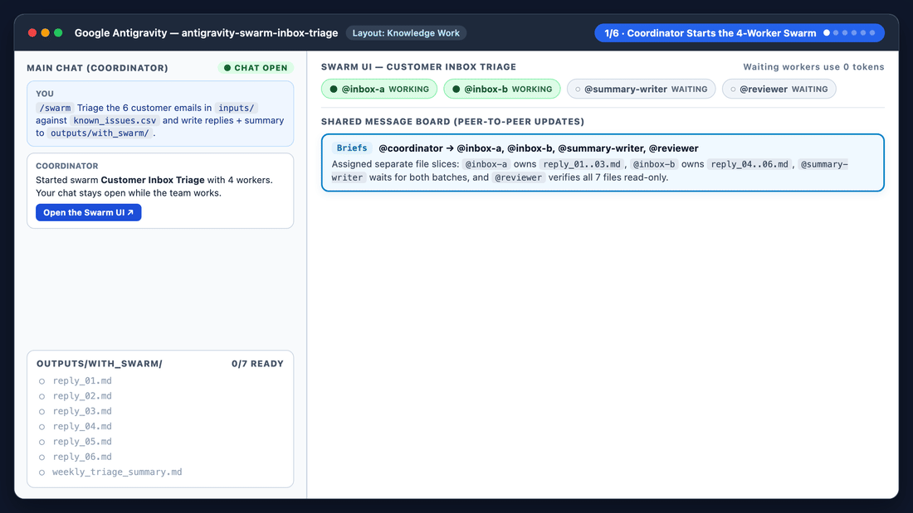

# Customer Inbox Triage — Normal Mode vs. `/swarm` in Google Antigravity

Companion repository for the tutorial: **[Getting More Done in Parallel with `/swarm` in Google Antigravity](./BLOG_POST.md)**.

This repository contains a simple, zero-math customer support scenario (**Customer Inbox Triage** + a 4-row `known_issues.csv` table) at two inbox sizes so you can clone the project and try **Normal Mode** alongside **`/swarm` Mode** step by step:

1. **Starter Walkthrough (`inputs/`, 6 emails → 7 output files):** Small enough to read end-to-end in about a minute so you can watch how a 4-worker `/swarm` divides files, shares notes on the message board, and reviews outputs.
2. **Larger Batch (`inputs_24/`, 24 emails → 25 output files):** Quadruples inbox volume to show how parallel `/swarm` batch workers pull ahead on completion speed while keeping each worker's context small and focused.



*(1080p MP4 replay also available in [`assets/video/inbox_swarm_replay.mp4`](./assets/video/inbox_swarm_replay.mp4).)*

---

## Repository Structure

```text
antigravity-swarm-inbox-triage/
├── README.md                             # Quickstart instructions
├── BLOG_POST.md                          # Full companion tutorial article
├── assets/
│   ├── images/                           # Diagrams & animated Swarm Board replay GIF
│   └── video/
│       └── inbox_swarm_replay.mp4        # 1080p MP4 replay of the 4-worker /swarm run
├── inputs/                               # 6-email starter inbox
│   ├── reply_guidelines.md               # Simple rules for replying & summarizing
│   ├── known_issues.csv                  # 4 known issues (FIXED or OPEN + workarounds)
│   └── emails/                           # 6 short customer emails (email_01..06)
├── inputs_24/                            # 24-email larger inbox
│   ├── reply_guidelines.md
│   ├── known_issues.csv
│   └── emails/                           # 24 customer emails (email_01..24)
├── prompts/
│   ├── prompt_without_swarm.txt          # 6-email Run 1: Normal Mode prompt
│   ├── prompt_with_swarm.txt             # 6-email Run 2: /swarm Mode prompt
│   ├── prompt_24_without_swarm.txt       # 24-email Run 1: Normal Mode prompt
│   └── prompt_24_with_swarm.txt          # 24-email Run 2: /swarm Mode prompt
├── outputs/                              # Reference outputs for 6-email runs
│   ├── without_swarm/
│   └── with_swarm/
├── outputs_24/                           # Reference outputs for 24-email runs
│   ├── without_swarm/
│   └── with_swarm/
└── logs/
    ├── swarm_board_log.md                # Recorded 6-email Swarm Board messages
    └── swarm_board_log_24.md             # Recorded 24-email Swarm Board messages
```

---

## Quickstart: Clone and Run the Scenario

### 1. Clone the repository
```bash
git clone https://github.com/rominirani/antigravity-swarm-inbox-triage.git
cd antigravity-swarm-inbox-triage
```

### 2. Open the folder in Google Antigravity
1. Open **Google Antigravity**, click **Projects** in the left sidebar, and open the cloned `antigravity-swarm-inbox-triage` folder.
2. *(Optional)* Open **Settings** (`Cmd+,` on macOS / `Ctrl+,` on Windows and Linux), go to **General → Interface Layout**, and choose **`Knowledge Work`** for a clean folder-and-document view.

### 3. Skim three short files (~1 minute)
* [`inputs/reply_guidelines.md`](./inputs/reply_guidelines.md) and [`inputs/known_issues.csv`](./inputs/known_issues.csv) — note which issues are `FIXED` (`ISS-101`, `ISS-103`) and which are still `OPEN` (`ISS-102`, `ISS-104`).
* [`inputs/emails/email_04_david.md`](./inputs/emails/email_04_david.md) — asks about Dark Mode chart labels (`ISS-102`, still `OPEN`).
* [`inputs/emails/email_01_priya.md`](./inputs/emails/email_01_priya.md) and [`inputs/emails/email_03_elena.md`](./inputs/emails/email_03_elena.md) — both report an unlisted iPhone `v4.2` Apple Pay checkout spinner.

### 4. Clear the reference outputs before running
```bash
rm -f outputs/without_swarm/* outputs/with_swarm/*
```
*(You can restore the reference outputs anytime with `git checkout -- outputs/`.)*

### 5. Run 1 — Without `/swarm` (Normal Mode)
Start a **New Conversation** in Antigravity and paste [`prompts/prompt_without_swarm.txt`](./prompts/prompt_without_swarm.txt):

```text
Triage the 6 customer emails in inputs/:
- Read inputs/reply_guidelines.md and inputs/known_issues.csv.
- Read all 6 customer emails in inputs/emails/.
- Write reply_01.md through reply_06.md plus weekly_triage_summary.md inside outputs/without_swarm/, making sure every reply matches known_issues.csv accurately and any new unlisted bug is flagged clearly.
```

### 6. Run 2 — With `/swarm` (Swarm Mode)
Start a second **New Conversation**, paste [`prompts/prompt_with_swarm.txt`](./prompts/prompt_with_swarm.txt), and click **Open the Swarm UI** once the Coordinator sets up the team:

```text
/swarm Triage the 6 customer emails in inputs/:
- Read inputs/reply_guidelines.md and inputs/known_issues.csv.
- Read all 6 customer emails in inputs/emails/.
- Write reply_01.md through reply_06.md plus weekly_triage_summary.md inside outputs/with_swarm/, making sure every reply matches known_issues.csv accurately and any new unlisted bug is flagged clearly.
```

### 7. Optional: Run the 24-Email Batch
To see `/swarm` draft 24 replies across parallel batch workers, clear `outputs_24/with_swarm/*`, start a **New Conversation**, and paste [`prompts/prompt_24_with_swarm.txt`](./prompts/prompt_24_with_swarm.txt).
